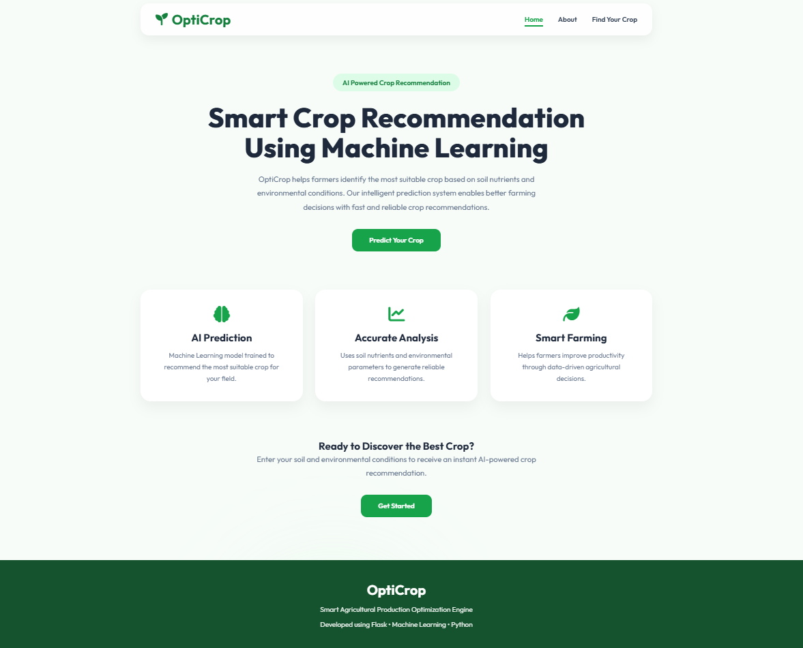
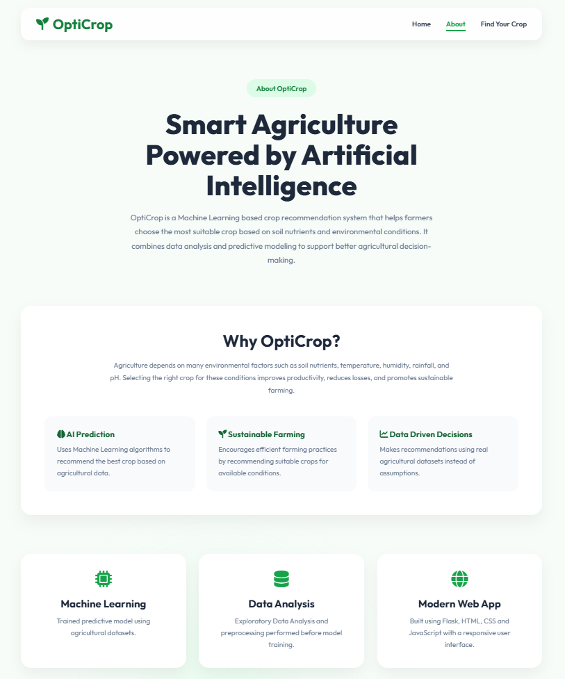
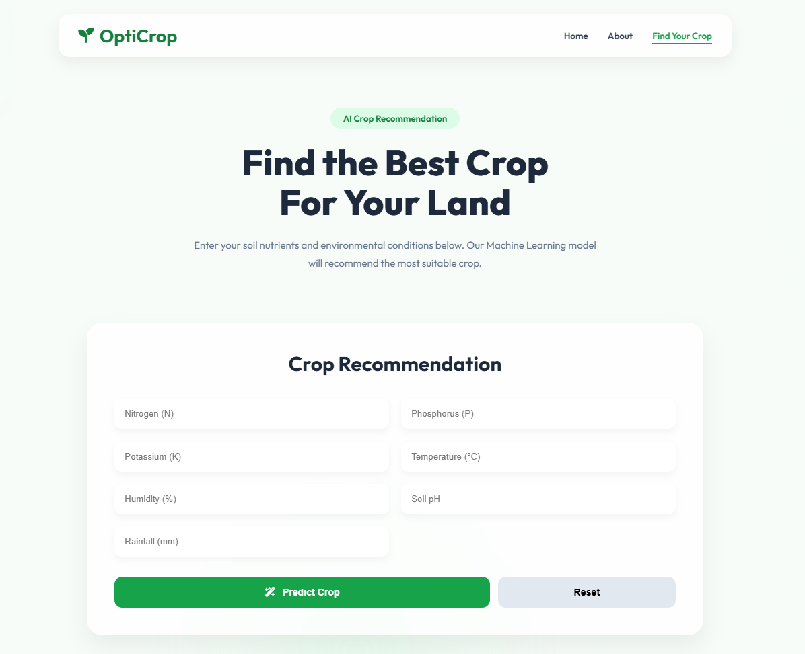
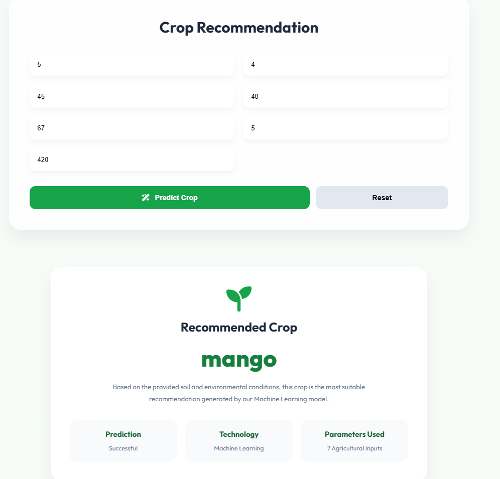

# OptiCrop

OptiCrop is a crop recommendation system built using Flask and Machine Learning.

The application recommends a suitable crop based on soil nutrients and environmental conditions. Users enter values like Nitrogen, Phosphorus, Potassium, Temperature, Humidity, pH, and Rainfall, and the model predicts the most suitable crop.

The project uses a Random Forest model for prediction and a simple Flask web application for the user interface.

---

## Features

- Recommend crops based on soil and environmental conditions
- Machine learning model using Random Forest
- Simple web interface built with Flask
- Exploratory Data Analysis (EDA) on the dataset
- Clean and easy-to-use interface

---

## Screenshots

### Home Page



### About Page



### Find Your Crop



### Recommendation Result



---

## How It Works

1. The user enters soil and environmental values.
2. Flask receives the input from the web page.
3. The trained Random Forest model processes the input.
4. The model predicts the most suitable crop.
5. The recommended crop is displayed on the result page.

---

## Tech Stack

**Backend**
- Python
- Flask

**Machine Learning**
- Scikit-learn
- Random Forest Classifier

**Frontend**
- HTML
- CSS
- JavaScript

**Data Analysis**
- Pandas
- NumPy
- Matplotlib
- Seaborn

---

## Project Structure

```text
OptiCrop/
│
├── app.py
├── model.pkl
├── requirements.txt
├── README.md
│
├── dataset/
│   ├── Crop_recommendation.csv
│   ├── train.csv
│   └── test.csv
│
├── notebook/
│   ├── EDA.ipynb
│   └── train_model.ipynb
│
├── screenshots/
│   ├── home-page.png
│   ├── about-page.png
│   ├── find-crop-page.png
│   └── crop-recommendation-page.png
│
├── static/
│   ├── css/
│   ├── js/
│   └── images/
│
└── templates/
    ├── home.html
    ├── about.html
    ├── findyourcrop.html
    ├── result.html
    └── index.html
```

---

## Installation

Clone the repository:

```bash
git clone https://github.com/aadith-v/OptiCrop.git
```

Move to the project folder:

```bash
cd OptiCrop
```

Create a virtual environment (optional):

**Windows**

```bash
python -m venv venv
venv\Scripts\activate
```

**Linux/macOS**

```bash
python3 -m venv venv
source venv/bin/activate
```

Install the required packages:

```bash
pip install -r requirements.txt
```

Run the application:

```bash
python app.py
```

Open your browser and visit:

```
http://127.0.0.1:5000
```

---

## Dataset

The project uses the Crop Recommendation Dataset containing soil nutrients and environmental parameters to predict the most suitable crop.

**Input Features**

- Nitrogen (N)
- Phosphorus (P)
- Potassium (K)
- Temperature
- Humidity
- pH
- Rainfall

**Output**

- Recommended Crop

---

## Future Improvements

- Deploy the application online
- Add weather API integration
- Fertilizer recommendation
- Crop disease prediction
- Mobile application
- Support for multiple languages

---

## License

This project is available for learning and educational purposes.